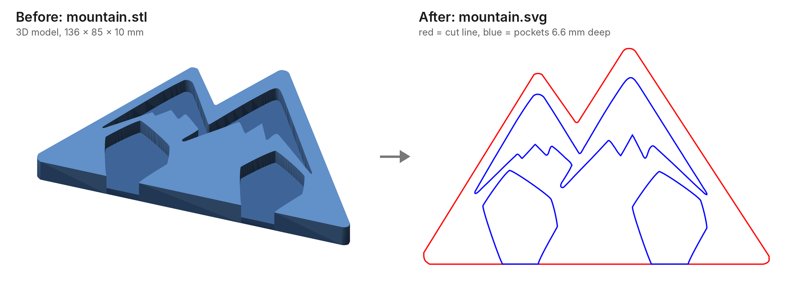

# stl-to-svg

Turn a 3D model (STL, OBJ or 3MF) into a full-size SVG outline you can send straight to a laser cutter.

It works like putting a real object on a scanner. The model is flattened, and its outline is traced at true size in millimeters. Pockets and steps in the part come out as separate colors, so you can engrave each depth with its own setting.



## Install

You need Python 3.9 or newer.

```
pip install -r requirements.txt
```

## Use

```
python stl_to_svg.py part.stl                 # writes part.svg next to the model
python stl_to_svg.py *.stl -o laser/          # convert a batch into one folder
python stl_to_svg.py part.stl --view bottom   # trace the other side (for parts modeled face-down)
python stl_to_svg.py part.stl --no-pockets    # outline and through-holes only
```

The script prints what it found, for example:

```
testplate.stl -> examples/testplate.svg
  view: top   size: 60.0 x 40.0 mm   thickness: 6.0 mm
  red: 1 outline(s), 1 through-hole(s)
  #0000ff: 1 area(s) 2.0 mm below the top
  #00a000: 1 area(s) 4.0 mm below the top
```

## What's in the SVG

| Color | Meaning |
|---|---|
| Red | Outer cut line, plus any hole that goes all the way through |
| Blue, green, magenta, orange, ... | One color per pocket or step depth: flat surfaces lower than the top |

For example, the test plate in [`examples/`](examples) has a through-hole (red), a 2 mm pocket (blue), and a 4 mm spot inside that pocket (green):


- The SVG is sized in millimeters, so it imports at 1:1 in LightBurn, Glowforge, xTool Creative Space, Inkscape and similar tools.
- Each depth is also its own SVG group, named like `depth_2.0mm`, which makes it easy to assign to a layer.
- Lines are hairline-thin with no fill. Use your laser software to set cut, score or engrave for each color.

## Options

| Option | Default | What it does |
|---|---|---|
| `--view` | `auto` | Side to trace: `auto`, `top`, `bottom`, `front`, `back`, `left` or `right`. `auto` looks at the flattest side. |
| `-o`, `--out` | next to input | Folder to write the SVGs to |
| `--no-pockets` | off | Only trace the outline and through-holes |
| `--min-area` | `1.0` | Ignore shapes smaller than this many mm² |
| `--simplify` | `0.01` | Smoothing tolerance in mm. Raise it (for example to `0.05`) if curves have too many points for your laser software. |
| `--margin` | `2.0` | Blank border around the drawing, in mm |

## How it works

1. The model is loaded with [trimesh](https://trimesh.org/) and turned so you're looking at the chosen side.
2. Every triangle is flattened onto the page and merged with [shapely](https://shapely.readthedocs.io/) into one shape. Its edge is the cut line, and any gaps inside it are through-holes.
3. For pockets, the script finds flat surfaces that face you and sit below the top. It keeps only the part of each surface you can actually see, so models built from overlapping solids (a base slab with walls on top, for example) still come out right.
4. Everything is written as SVG paths in millimeters.

## Limits

- Only outlines and flat floors are traced. A domed or sloped surface, like a sculpted figure, comes out as its outline only.
- Text or detail embossed on a curved surface won't show up.
- Units are assumed to be millimeters, which is what nearly all STL files use.

## License

MIT. See [LICENSE](LICENSE).
