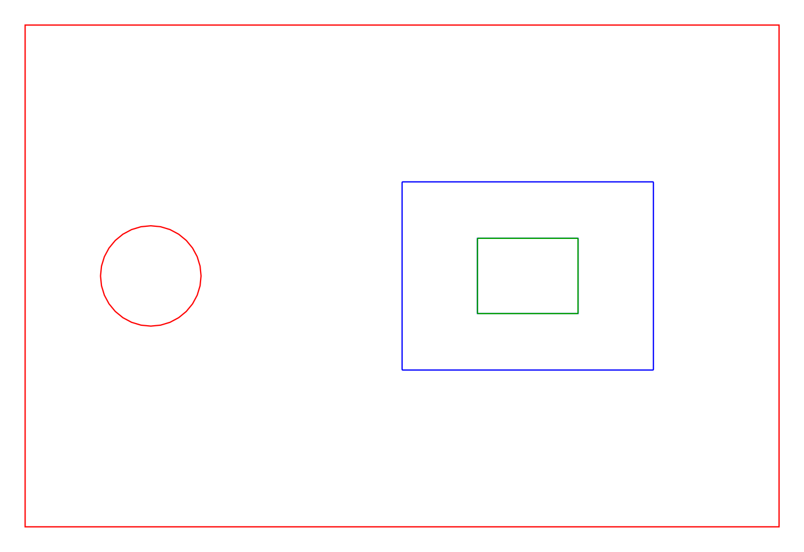
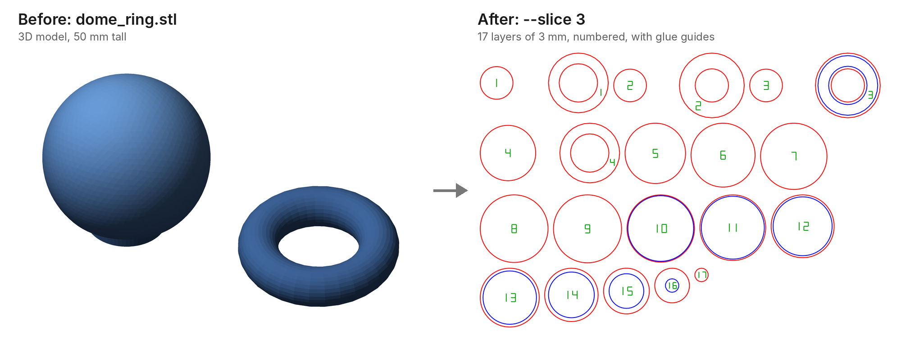

# stl-to-svg

Turn a 3D model (STL, OBJ or 3MF) into full-size SVG files you can send straight to a laser cutter.

**Use it in your browser, nothing to install: [dmg159.github.io/stl-to-svg](https://dmg159.github.io/stl-to-svg/)**
Drop in an STL or OBJ file, pick a mode, and download the SVG. Your file never leaves your computer.

Made by [Dillon Makes](https://dillonmakes.tech).

It has two modes:

- **Outline mode** works like putting a real object on a scanner. The model is flattened, and its outline is traced at true size in millimeters. Pockets and steps in the part come out as separate colors, so you can engrave each depth with its own setting.
- **Slice mode** cuts the model into layers as thick as your sheet material, for example 3 mm plywood. You laser-cut every layer and glue the stack back together into the 3D shape.


## Python version

The web version and the Python script give the same results. The script also reads 3MF files and can convert a whole folder at once.

You need Python 3. It's tested with Python 3.12 and 3.13.

```
pip install -r requirements.txt
```

## Outline mode

```
python stl_to_svg.py part.stl                 # writes part.svg next to the model
python stl_to_svg.py *.stl -o laser/          # convert a batch into one folder
python stl_to_svg.py part.stl --view bottom   # trace the other side (for parts modeled face-down)
python stl_to_svg.py part.stl --no-pockets    # outline and through-holes only
```

The script prints what it found, for example:

```
testplate.stl -> examples/testplate.svg
  view: top   size: 60.0 x 40.0 mm   thickness: 6.0 mm
  red: 1 outline(s), 1 through-hole(s)
  #0000ff: 1 area(s) 2.0 mm below the top
  #00a000: 1 area(s) 4.0 mm below the top
```

| Color | Meaning |
|---|---|
| Red | Outer cut line, plus any hole that goes all the way through |
| Blue, green, magenta, orange, ... | One color per pocket or step depth: flat surfaces lower than the top |

Each depth is also its own SVG group, named like `depth_2.0mm`, which makes it easy to assign to a layer. For example, the test plate in [`examples/`](examples) has a through-hole (red), a 2 mm pocket (blue), and a 4 mm spot inside that pocket (green):



## Slice mode

```
python stl_to_svg.py part.stl --slice 3                      # 3 mm layers -> part_layers.svg
python stl_to_svg.py part.stl --slice 3 --sheet-width 400    # lay out for a 400 mm wide bed
python stl_to_svg.py part.stl --slice 6 --view front         # stack along a different direction
```



All the layers come out on one sheet, laid out left to right and wrapped into rows at your sheet width (300 mm unless you set `--sheet-width`).

| Color | Meaning |
|---|---|
| Red | Cut line for each layer, including holes |
| Blue | Glue guide: where the next layer up sits. Score or lightly engrave it. |
| Green | Layer number, in single-stroke digits. Score or lightly engrave it. Layer 1 is the bottom. |

The script tells you how tall the finished stack will be:

```
dome_ring.stl -> examples/dome_ring_layers.svg
  view: top   model height: 50.0 mm   17 layer(s) of 3 mm = 51.0 mm stack
  sheet: 297 x 205 mm
  red: cut lines   blue: glue guides   green: layer numbers (1 = bottom)
```

How slicing works and what to expect:

- **Stacking direction:** layers stack along the model's up direction (Z), the way it would sit on a 3D printer bed. Use `--view` to stack along another direction.
- **Where each layer is traced:** each layer is traced through its middle. For 3 mm sheets, that's at 1.5 mm, 4.5 mm, 7.5 mm and so on.
- **Stack height:** the stack is always a whole number of sheets, so it can come out slightly taller or shorter than the model. A leftover sliver thinner than half a sheet is dropped.
- **Hidden numbers:** numbers go in the area the next layer will cover when there's room, so they're hidden once the stack is glued. The top layer's number will show.
- **Where guides appear:** a guide only appears where the next layer actually lands on this one. On a shape that gets wider as it goes up, like the bottom half of a ball, there's nothing to draw, so line those layers up by eye.
- **Separate pieces:** a layer that splits into separate pieces gets the same number on every piece.
- **Turning extras off:** use `--no-guides` or `--no-numbers` to leave them out, or turn off that color in your laser software.

## All options

| Option | Default | What it does |
|---|---|---|
| `-o`, `--out` | next to input | Folder to write the SVGs to |
| `--view` | `auto` | `auto`, `top`, `bottom`, `front`, `back`, `left` or `right`. In outline mode, the side to trace (`auto` = the flattest side). In slice mode, the stacking direction (`auto` = top). |
| `--no-pockets` | off | Outline mode: only trace the outline and through-holes |
| `--slice MM` | off | Slice mode: layer thickness in mm, the same as your sheet |
| `--sheet-width` | `300` | Slice mode: width of your sheet or laser bed in mm |
| `--no-guides` | off | Slice mode: leave out the glue guides |
| `--no-numbers` | off | Slice mode: leave out the layer numbers |
| `--min-area` | `1.0` | Ignore shapes smaller than this many mm² |
| `--simplify` | `0.01` | Smoothing tolerance in mm. Raise it (for example to `0.05`) if curves have too many points for your laser software. |
| `--margin` | `2.0` | Blank border around the drawing, in mm |

The SVGs are sized in millimeters, so they import at 1:1 in LightBurn, Glowforge, xTool Creative Space, Inkscape and similar tools. Lines are hairline-thin with no fill. Use your laser software to set cut, score or engrave for each color.

## How it works

1. The model is loaded with [trimesh](https://trimesh.org/) and turned so you're looking at the chosen side.
2. **Outline mode:** every triangle is flattened onto the page and merged with [shapely](https://shapely.readthedocs.io/) into one shape. Its edge is the cut line, and any gaps inside it are through-holes. For pockets, the script finds flat surfaces that face you and sit below the top, keeping only the part of each you can actually see. That way, models built from overlapping solids, such as a base slab with walls on top, still come out right.
3. **Slice mode:** the model is cut by a flat plane through the middle of every layer. Each triangle's facing direction tells which side of the cut is inside the material, so the outlines are filled by counting how many solids surround each spot. Overlapping solids add up instead of cancelling out, and a hole inside a solid stays a hole.
4. Everything is written as SVG paths in millimeters.

## Limits

- Outline mode only traces outlines and flat floors. A domed or sloped surface, like a sculpted figure, comes out as its outline only. Slice mode handles those shapes.
- Slice mode needs a closed model whose triangles face outward, which is what CAD programs and model sites normally export. Small gaps are bridged, but a model with large holes in its surface may lose parts of some layers.
- Units are assumed to be millimeters, which is what nearly all STL files use.

## Testing

Both versions have their own unit tests, and a third set of tests checks that they give the same results.

| Tests | What they cover |
|---|---|
| [`tests/test_python.py`](tests/test_python.py) | The Python script: file types (binary and ASCII STL, OBJ, 3MF), every view, outlines, holes, pocket depths, floors hidden under overlapping walls, slicing, glue guides, layer numbers, sheet layout, warnings and the command line |
| [`tests/core.test.js`](tests/core.test.js) | The same behavior in the web version |
| [`tests/test_parity.py`](tests/test_parity.py) | Runs both versions on every test model in both modes, and checks the SVGs match: sheet size, shapes in every color, areas, where the lines are, and which pieces are numbered |

Most tests use small models from [`tests/fixtures`](tests/fixtures) with known right answers, such as a 20 × 30 × 5 mm block or a sphere whose slices should have exact radii. Some tests use real models from Thingiverse, the XYZ calibration cube and #3DBenchy ([credits](tests/fixtures/real/CREDITS.md)). Each bug found so far has its own test, so it can't quietly come back.

To run them:

```
pip install -r requirements-dev.txt
pytest                 # Python tests and the Python vs web comparison (needs Node.js)
node --test            # web version tests
pytest -m "not slow"   # skip the real-model tests, which take about a minute
```

GitHub runs both sets of tests on every push.

## Web version

The page lives in [`docs/`](docs) and is published with GitHub Pages. It's a JavaScript port of the script (`docs/core.js`) that uses [Clipper](http://www.angusj.com/) by Angus Johnson (Boost Software License) for the 2D shape math. There's no build step: the files are served as they are.

## License

MIT. See [LICENSE](LICENSE).

Made by [Dillon Makes](https://dillonmakes.tech).
